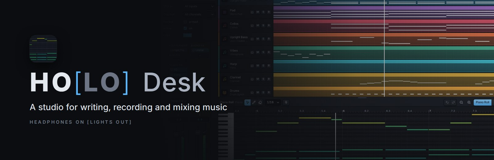
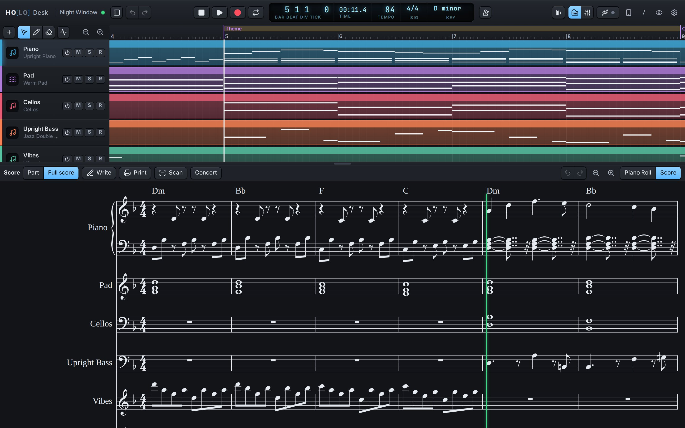
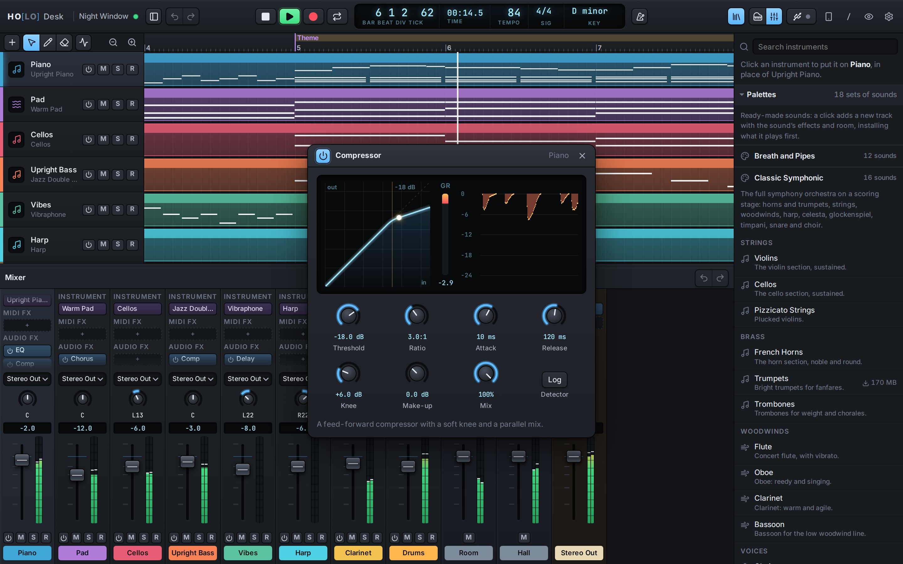
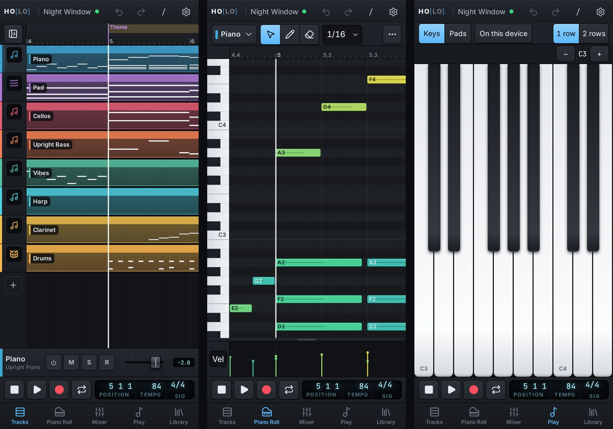
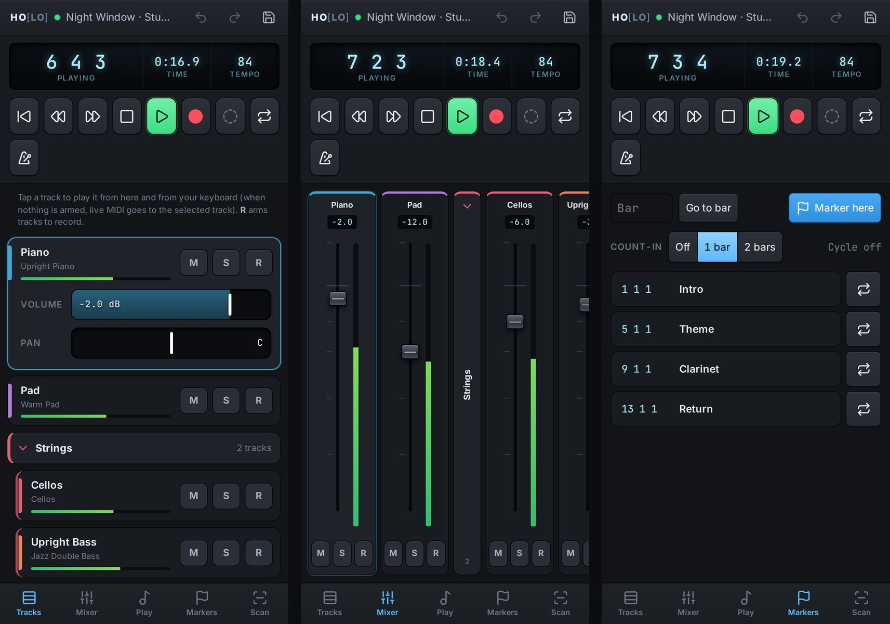
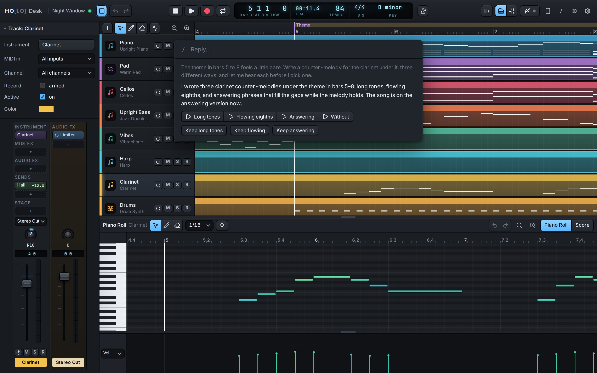
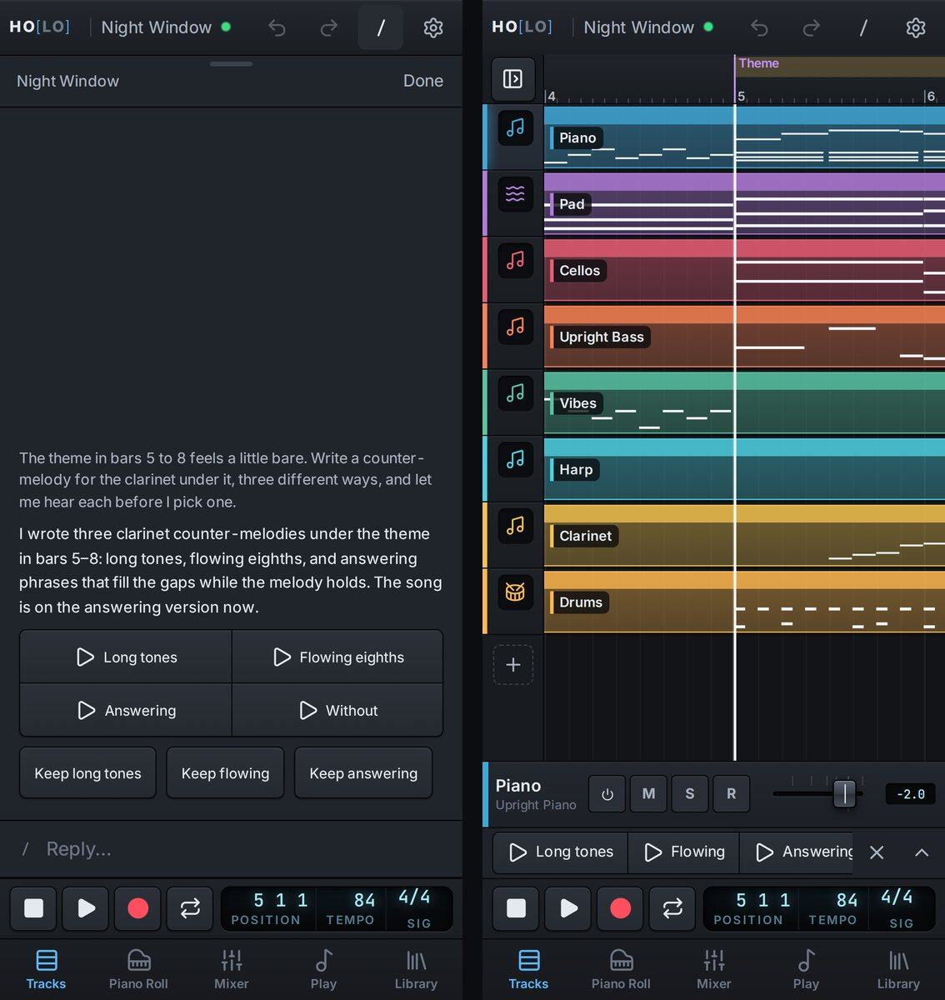

<p align="center"></p>

<p align="center"><b>A music studio that runs in your browser.</b><br>Write a song, play it on your keyboard, record your voice or your guitar, mix it, and print the score:<br>on your computer, your tablet and your phone, with nothing to sign up for.</p>

![HO[LO] Desk playing a song: the tracks, one track's channel strip on the left, and its notes in the Piano Roll below](docs/images/studio.jpg)

## What it is

HO[LO] Desk is a digital audio workstation, the kind of program music is made in (Logic Pro, GarageBand,
Ableton Live, Cubase), built to run in a web browser. You start it on one computer of your own, and
then open it like a web page: on that computer, or on any other device you own.

- **Free and open source.** MIT licensed. No account, no subscription, no ads, and nothing is sent anywhere.
- **Yours.** It runs on your computer, and your songs stay in a folder there.
- **A whole studio.** Tracks, a Piano Roll, a score, audio recording, a mixer, 33 effects, 90 built-in
  synths and 66 free sample packs, from concert grands to a full orchestra and about twenty drum kits.
- **Familiar.** It's laid out the way Logic is, with Logic's key commands, so if you've used a studio
  before you already know where things are.
- **On every screen.** The same studio on a desktop, a tablet and a phone, and your phone can be its
  remote control.
- **With a helper, if you want one.** You can ask for things in plain words ("write a counter-melody for
  the clarinet") and an AI agent does them in your song. It's off until you turn it on, and the studio
  is complete without it.

**Jump to:** [A look around](#a-look-around) · [Is it for you?](#is-it-for-you) · [Install it](#install-it) ·
[Reference](#reference)

## A look around

Every picture here is the real studio playing "Night Window", the demo song that comes with the
repository.

### Write

A song is a stack of **tracks**, one for each instrument, running left to right in time. Select a track
and its notes open in the **Piano Roll** underneath: each colored strip is a note: higher up is higher in pitch,
and a longer strip is a longer note. Drag notes where you want them, stretch them, draw new ones, set how hard each is
played, and undo anything. That's the picture at the top of this page.

You don't have to click notes in. Plug in a MIDI keyboard or drum pads and play, type on your computer's
keyboard, or tap the keys and pads on a touch screen, and record what you played with a metronome and a
count-in.

### Program the drums

Select a drum track and choose **Steps** beside Piano Roll: the same notes as a drum machine shows them.
A row for each piece of the kit, a step for each sixteenth, a page of bars at a time. Tap a step to
light it and hear it, drag along a row to paint a run of them, drag a lit step up or down for how hard
it's hit. While the song plays a light runs along the steps and what's struck jumps.

### Read it as a score

Press <kbd>N</kbd> and the same notes are sheet music. The score and the Piano Roll are two views of one
song: change a note in either and it changes in both. You can write the way you would in a notation
program (type letters and note values, play them in, or click on the staff), add dynamics, slurs,
lyrics, chord symbols and repeats, and print the full score or each player's part.



Already have the music on paper? **Scan** it: photograph a page with your phone, or open a PDF, and
HO[LO] reads it into the song, then shows each line of the page above the bars it became so you can
check it. Scores also come and go as MusicXML, to and from MuseScore, Sibelius, Finale and Dorico.

### Record

Audio tracks record a microphone, a guitar or anything else through your audio interface, or take the
audio files you drop on them. Trim a take, fade it, change its length without changing its pitch, and
even edit a recording note by note: nudge a sung note that's flat, straighten its drift, move it in time.

### Mix

Every track has a channel strip: its instrument, its effects, how much it sends to shared reverbs, where
it sits left to right, and a fader. There are 33 effects built in (equalizers, compressors, reverbs,
delays, tape and tube colors, a pitch corrector, a drummer that plays along), each with its own window,
and anything you can turn can be **automated**: drawn as a line that moves it through the song.



On the right is the **Library**, where sounds come from. **Palettes** are ready-made sets for a style
(a symphony orchestra, a felt piano with strings, a gamelan, cinematic synth-pop): click a sound and it
arrives on a new track with its effects and its room already set. The sampled instruments are free
libraries HO[LO] downloads when you ask for them, and you can import your own. When the song is done,
<kbd>Ctrl B</kbd> bounces it to an audio file.

### On your phone

The studio isn't a cut-down "mobile version" on a phone: it's all there, rearranged for a small screen
and a finger. Tracks, the Piano Roll, the score, the mixer, the Library, and a keyboard and drum pads to
play.

<p align="center"></p>

A phone can also be **HO[LO] Remote**: prop it by your instrument and it drives the studio on your
computer's screen. Play, stop, record, pick a track, ride its fader, jump to a marker.

<p align="center"></p>

### Ask for it in plain words (optional)

HO[LO] has a command bar (<kbd>Ctrl /</kbd>) where every command, track and marker is found by name.
If you turn the **agent** on, the same bar also takes requests in plain words, and an AI agent carries
them out in the open song: write a bass line, harmonize a melody, fix what's muddy in the mix, read a
scanned page.



This is a real request and its real reply. The agent wrote three clarinet lines (the notes in the Piano
Roll underneath are one of them) and laid out its own controls for what comes next: play each, play the
song without, keep the one you like. What matters about it:

- **It's off by default**, and while it's off nothing in the studio mentions it.
- **It uses an AI subscription you already have**: your own Claude Code, Codex, Cursor or Antigravity,
  installed on the computer that runs HO[LO] and signed in as you. HO[LO] has no AI service of its own
  and no API keys.
- **It can only touch the open song.** No files, no shell, no web. Everything it does for one request
  is a single step you can undo.
- **You press play.** It doesn't start playback or move your view unless that's what you asked for.

On a phone the conversation gets a page of its own, and the controls from the last reply stay within
reach above the transport while you listen:

<p align="center"></p>

If you work in a terminal, the `holo` command and a Claude Code skill do all of this from there too.
[More about the agent](#the-agent-and-the-holo-command).

### Music for games and apps

If you're building a game or an app whose music is code, HO[LO] can be its studio. A piece goes from the
project into HO[LO] and your edits go back, and `holo init` gives a new project its songs folder and a
pinned copy of HO[LO]'s engine, so the project builds its own music, sample for sample as the studio
plays it, with or without HO[LO] Desk installed ([how](docs/creations.md)).

## Is it for you?

**A good fit if you**

- want a free studio to write, arrange and record songs, and don't want an account or a subscription;
- write for real instruments (piano, strings, orchestra, band) and want notation and a studio in one place;
- want the same song on your desktop, your laptop, your tablet and your phone;
- are comfortable running a few commands in a terminal once, to install it (or you already use Docker);
- make music for a game or an app and want it built from source, reproducibly.

**Probably not if you**

- need your VST, AU or AAX plugins: HO[LO] plays its own instruments and effects, and sample packs
  (SFZ, Logic's EXS, folders of WAV files), not third-party plugins;
- want a website to sign in to: there isn't one, you run HO[LO] yourself;
- need a double-click installer today: installing takes Node.js or Docker and a terminal.

**What you need:** a computer to run it on (Linux, macOS or Windows) with Node.js 24 or Docker, a few
GB of disk for the sampled instruments, and a current browser. Chrome, Edge and Firefox can use a USB
MIDI keyboard; an iPhone or iPad reaches one over network MIDI. Headphones recommended, lights optional.

## Install it

You need Node.js 24 or newer and pnpm 10 (`corepack enable`), or just Docker.

```bash
git clone https://github.com/shooter-git/holo-desk.git && cd holo-desk
pnpm install
cp .env.example .env
pnpm packs install          # the sample libraries (a few GB), or install them from the studio's Library
pnpm build && pnpm start    # or `pnpm dev` while working on HO[LO] itself
```

Open <http://localhost:47800> and press **Start the studio**. There are ninety built-in synths,
so something plays before any pack is installed. Scanned sheet music is read by recognition
engines that run in Docker: with Docker on this computer, the server fetches them (a few GB) and starts
them the first time a scan needs them (`pnpm omr off` if you'd rather not).

**In Docker** (the server, the built studio and your data in `./data`), from the image CI publishes:

```bash
cp .env.example .env
pnpm run update             # pull ghcr.io/shooter-git/holo-desk:stable and start it (or: pnpm run update main),
                            # with the recognition engines that read scans beside it (pnpm omr off: without)
pnpm run autoupdate on      # then it keeps itself up to date (Linux: a systemd timer, as you)
pnpm run runner-service on  # and the runner, for creations' renders and the agent (Linux: a service, as you)
# on a server nobody stays logged into, once: the timer and the runner keep running after you log out,
# and start at boot (without it, systemd stops them at logout and waits for your next login)
sudo loginctl enable-linger "$USER"
```

Install sample packs from the studio's Library (**More packs → Install**; browse them at
[HO[LO] Packs](https://github.com/shooter-git/holo-packs)). Every image is published by
CI with a signed record of what built it: `stable` and the version on each release, `main` on every
change merged, `sha-<commit>` always. The timer looks every 15 minutes and never restarts HO[LO] while a
studio is playing or recording, the host is making a bounce, or the agent is working on a request; an
open studio offers to reload when its host has been updated. Songs
and packs live in `./data`, outside the image, so an update never touches them. Before a new version
starts, the songs' database is copied to `data/backups` (the last three kept, and nothing else you keep
there is touched; with no room on the disk the update says so and goes on), and a version that doesn't
start, or doesn't answer within three minutes, is undone:
HO[LO] goes back to the one before, and waits for a newer one (`journalctl --user -u holo-update` says
what happened; `pnpm run update` tries again by hand). A copy is only ever put back by hand: stop
HO[LO] (`pnpm down`), put it in `data` as `holo.db`, with no `holo.db-wal` or `holo.db-shm` beside it,
and start it again. An update also moves this
checkout to the code of the image it started (a release's tag, or main's head), so its compose file, its
tools and the runner match the server, and starts the runner again. `pnpm run update` takes a checkout on
main along (it's then on no branch, and follows); a checkout on any other branch, or with changes or
commits of your own, is your work and stays as it is. (A checkout older than v0.7.2 doesn't move itself
yet: bring it up to date once.)

To run your own changes instead, `pnpm run up` builds from this checkout (`holo-desk:local`); automatic
updates wait until you `pnpm run update` again.

## Reference

Everything below is the detail: what's in the box, how to reach HO[LO] from your other devices, how to
set up the agent, the sample packs, the key commands, and how the repository is laid out.

- [Everything it does](#everything-it-does)
- [Your other devices](#your-other-devices), and [a studio, a screen and a remote](#a-studio-a-screen-and-a-remote)
- [Play it in a few milliseconds: HO[LO] Engine](#play-it-in-a-few-milliseconds-holo-engine)
- [The agent and the `holo` command](#the-agent-and-the-holo-command)
- [Sample packs](#sample-packs)
- [Key commands](#key-commands)
- [Development](#development)
- [Privacy and security](#privacy-and-security)
- [Made with HO[LO] Desk](#made-with-holo-desk)

## Everything it does

- **Write and edit.** Tracks and regions on a timeline. A Piano Roll with the keyboard down the left: drag notes to new pitches and times, stretch them, set velocities, and draw any controller (mod wheel, expression, sustain, pitch bend, aftertouch, any CC). The Piano Roll shows the song's key: its notes' rows are lit, a note outside it is hatched, and with **Snap to key** on, notes move by its steps (**Move into key** brings the strays in). Quantize (all the way to the grid or part of it, straight or with a swing), transpose, split, repeat, undo everything: the undo history is a menu you can step back through, and it's kept across a reload. The **Arrangement lane** (View, off to begin with) shows the song's sections as blocks, each from a marker to the next: drag one to move its bars, everything in them with it, or repeat, split, rename and delete from its menu. The **Chords lane** shows the song's chord symbols over the tracks, typed where they fall. Drag tracks into a new order, and **Make inactive** the ones you aren't using: they stay in the song, but nothing is loaded or played for them.
- **Track stacks.** Tracks that belong together go under one header: right-click a track for **New stack with this track** (<kbd>Ctrl Shift D</kbd>) or **Add to** a stack, or drag a track under a stack's header, among its tracks, or back out. The header's arrow folds the stack away (on this device: a phone can keep a big song folded while the desktop has it open), its M and S mute and solo its tracks together, its on/off switches them all off, and its lane shows their parts as thin strips. **Mix through a bus** makes it a summing stack: a bus named after it, the tracks routed there, and the bus's fader on the header, for one level and one chain of effects for the group. A stack never changes what you hear by being one; whenever a track's output changes (into a stack's bus, back to Stereo Out) the studio does it in that same step and says so, and **Unstack** leaves the tracks where they are, playing as they did. Drag the header to move the whole stack. In the **Mixer** a stack has a narrow tab before its strips, with the same arrow, M and S, and a closed stack's strips are folded away there too; **HO[LO] Remote** shows the stacks in its Tracks and Mixer tabs and folds them on its own.
- **Step Grid.** A kit's part as steps (**Steps**, beside Piano Roll, on any drum track; on a phone it's the editor's tab). Rows are the kit's pieces by name, the ones the part plays and the kick, snare and hats always (**All pads** for the rest); a pad's name plays it. Tap to light a step, drag along a row to paint or erase, drag a lit step up or down for its velocity (on a touch screen, rest a finger on it first), right-click or hold for Ghost, Soft, Normal and Accent. A step is as full and as bright as it's hit hard. Each row's ⋯ fills every step, every other, on or off the beats; spreads 3, 5 or 7 hits evenly over the bar (a Euclidean rhythm); shifts the row a step; varies how hard it's hit; or lets you type it as a line (`x...x...x.o.x...`). **Swing** pushes every other step late, from a touch to a hard shuffle, and the page's ⋯ copies its bars on to the next ones. The grid is 1/8 to 1/32, or triplets, and a page holds one, two or four bars, as many as the window has room for; the strip above shows the whole part bar by bar. A lit step is a note of the track, nothing more: one played a little early or late shows where it really is and isn't moved by being looked at, and the Piano Roll and the Score show the same part. From the keyboard, arrows move over the steps, Enter lights one or puts it out, 1 to 4 set how hard.
- **Play it live.** USB MIDI keyboards and drum pads through Web MIDI, delivered to the audio engine through shared memory: a key you press sounds in the next 128-frame block. You can also play the computer keyboard (Musical Typing) or the touch keyboard (one row of keys or two) and drum pads on a phone. Record with count-in, cycle and metronome, or don't: **Capture** (<kbd>Shift R</kbd>, the dashed circle beside Record, or a finger held on Record) keeps what you just played anyway, pedal and bends included, on the track that sounded it. Record with count-in, cycle and metronome (right-click the metronome, or open Settings › Metronome, for its sound and volume), and tap a tempo in. For the shortest time from key to ear, run [HO[LO] Engine](#play-it-in-a-few-milliseconds-holo-engine) on the computer you play on.
- **Scores.** Any track as notation (press <kbd>N</kbd>): the score and the Piano Roll are the same notes, so an edit in either shows in both. Write by typing letters and note values, playing a MIDI keyboard, or clicking on a staff; edit as in a notation program (drag a note up or down, give it a sharp, flat or new value, copy and paste, from the keys, a right click, a long press or a touch screen's tools); add dynamics, articulations, slurs, lyrics, chord symbols, repeats and endings, D.C. and D.S. jumps, guitar tab and drum parts. Markings sound as they read, and playback follows the repeats. MusicXML goes in and out (MuseScore, Sibelius, Finale, Dorico), and the full score or each part prints, or saves as a PDF.
- **Scan sheet music.** Photograph a page with your phone or open an image or a PDF: HO[LO] straightens it, finds the systems and shows each line of the page above the bars it became, for a quick review. Open-source recognition engines (Audiveris and homr, on by default) read it into the song as one undo step, and read it again to flag the bars where they differ from what's written. The agent, if you turn it on, can read it too.
- **Record and edit audio.** Audio tracks record a microphone or an instrument through an audio interface (lined up with what you heard, using this device's measured round trip), or take WAV, FLAC, MP3, Ogg and AIFF files dropped on the tracks. Trim from either edge, drag fades, set gain, normalize, and time-stretch without changing pitch (Alt-drag a region's end, as in Logic) in the tracks area or the Audio Editor. The Audio Editor's **Notes** view shows a recording as the notes in it, each one editable: its pitch, drift and vibrato, the glide into it, its formant, level and timing, split, joined, or pasted over with another note's sound.
- **Mix and automate.** Channel strips with instruments, MIDI effects, audio effects, sends, buses, pan, faders and meters. Put a channel on a **Stage**: a near seat and a far seat, each with its own rooms and depth, and a Distance that moves it between them. Automation lanes (press <kbd>A</kbd>) draw how volume, pan, mute, sends, distance and any plugin parameter move through the song, in straight lines or smooth curves, sample-accurately. Plugin windows have presets, and their values can be typed.
- **Bounce.** <kbd>Ctrl B</kbd> renders the song (or the cycle) to a 24-bit WAV with the same engine, faster than real time, and keeps a copy with the song. A phone or a tablet has the host make it (the same file: a big song's sounds are more than a phone's browser holds) and saves it with a tap when it's done, and any device can choose where its bounces are made in **Settings › Audio**. A song's bounces are kept under its row in **Songs** while it's open, folded away until you open them, each to save again or delete. **Export stems** (in Songs, beside Bounce, or from the bar) gives a 24-bit WAV for each track the mix is made of, each with its own effects and its share of the buses it's sent to, in one ZIP: the host makes it, whatever the device, and keeps it with the song's bounces. Before it starts, the dialog lists the files, how big the ZIP will be, and anything that would stop them adding up to the mix (the song's finish, a limiter or a compressor that several tracks share). In a song with track stacks the stems can be **Stacks and loose tracks** instead: a file for each stack, its tracks together, and one for each track in no stack. A song can carry its **finish** (mastering to a loudness under a true-peak ceiling, with glue) and be marked a **loop**, so a game's music renders as it plays forever, its end ringing into its start.
- **Real instruments.** Free sample libraries ([66 packs](#sample-packs): concert grands, a full orchestra, about twenty drum kits, guitars and basses, saxophones, gamelan, tabla, erhu and more) with every sample measured for its true pitch, level and loop. **Performance** instruments play a whole part as a real player would (dynamic layers, round robins, legato hand-overs, re-bowing, attacks that land on the beat), and **Glass** is a bowed-glass voice. **Import your own packs** as SFZ, Logic's EXS or folders of WAV files.
- **Built-in synths.** Ninety of them in eight families (keys, organs and reeds, synths, bells and glass, textures, voices, world, drums and percussion), so something always plays, with no download.
- **An AI collaborator, if you want one.** A [Claude Code](https://claude.com/claude-code) skill that reads the open session and writes into it as undoable steps. It harmonizes, writes counter-melodies and bass lines, sets up a live harmonizer that follows your playing, and listens to what you play and answers it. The studio's command bar can take the same kind of request too, carried out by your own Claude Code, Codex, Cursor or Antigravity, once you turn that on.
- **Round trips with your own projects.** A game or an app whose music is code can send a piece into HO[LO] and get your edits back, and render the song itself so you can compare its own sound with the studio's, edits and all ([how](docs/creations.md)).
- **Music for your next project.** `holo init` gives a new game or app ("an experience") its songs folder and a pinned copy of HO[LO]'s engine, so the project builds its own music, sample for sample as the studio renders it, with or without HO[LO] Desk; `holo update-engine` moves it on when you choose ([how](docs/creations.md#music-for-a-new-project-an-experience)).
- **Everywhere.** Desktop, tablet and phone (portrait and landscape), installable as an app, in Docker, reached by your own devices over HTTPS on your tailnet. Changes you haven't saved yet, and takes you've just recorded, are kept on the device until the host has them.

<details>
<summary><b>The 33 stock plugins</b></summary>

| | |
|---|---|
| **EQ** | Channel EQ, Parametric EQ (eight free bands), Studio EQ (cuts to 48 dB an octave, shelves, four bells and Proportional Q) |
| **Dynamics** | Compressor, Character Compressor (Clean, FET, VCA and Opto circuits, with an output stage and a limiter), Noise Gate, Transient Softener, Limiter (with a soft knee) |
| **Reverb** | Space Designer (convolution with generated rooms, halls and cathedrals, or any impulse response), Shimmer, Space Reverb, Room Reverb (early reflections from a room's walls, then a tail with its own decay for the lows and highs), Smooth Hall, String Resonance (a grand's strings ringing in sympathy, with an extended grand's bass strings) |
| **Delay** | Tape Delay, Dual Delay (each side its own note, groove, feedback and crossfeed) |
| **Modulation** | Chorus, Wow & Flutter, Rotary Speaker, Phaser, Tremolo (or auto-pan) |
| **Color** | Tape Warmth, Saturation, Lo-fi |
| **Tools** | Stereo Width, Drum Replacer (each hit on a drum track played again on any kit, and turned into notes), Pitch Correction (a voice pulled to the nearest note of a key and scale, hard and robotic or natural) |
| **MIDI effects** | Arpeggiator, Harmonizer, Scale Quantizer, Velocity Processor, Session Drummer (a drummer that plays along in ten styles, with fills) |

Plugins that look ahead (the limiter, Shimmer, the Drum Replacer, Pitch Correction) are
delay-compensated: everything else waits for them, so it all arrives together. **Low Latency Mode**
(Settings › Audio) lets them stop holding the sound back while you play; bounces always use them in full.

</details>

<details>
<summary><b>The built-in synths</b></summary>

Ninety sounds in eight families, from these engines: **Fat Mono** and **Fat Poly** (three drifting
oscillators driven into a transistor-ladder filter), **Ethereal Pad** and **Ethereal Keys** (a wide
supersaw in a shimmering hall of its own), a **tonewheel organ** with its rotating speaker, modeled
**tine, reed and clav** electric keys, a four-operator **FM** synth, a **six-operator FM** synth with a
free matrix and a window of its own, a morphing **wavetable** synth, **Prism** (a synth that morphs
between four sources: oscillators, partials, a sample and grains, with a window of its own), evolving
**drones**, an analog-style **drum machine** (four machines and a drum synth, on the General MIDI drum
keys), and modeled **flutes, pipes, zithers, lutes, free reeds, a glass harmonica, a choir, taiko and
war drums, gongs, an anvil, a kalimba and a shimmering bell**. Most have six knobs in their window (the
button on the instrument slot).

</details>

## Your other devices

Browsers only allow MIDI and shared-memory audio on a secure page. HO[LO] listens on this machine only
(`127.0.0.1`), and [Tailscale](https://tailscale.com) gives your own devices a trusted HTTPS address
with nothing to install on them but the Tailscale app:

```bash
pnpm tailnet on             # https://<this machine>.<your tailnet>.ts.net:47801
```

HO[LO] is hosted on one machine and played on others. Plug your keyboard or drum pads into the laptop
(or other computer, or Android phone) you'll play on, open that address in Chrome, Edge or Firefox
there, and wear your headphones on that device. The notes never cross the network: only the song and
the samples come from the host (once; the device keeps the samples). Give each device a name in
**Settings › General** so the others and the AI know which is which. If the host goes away, the
studio keeps working and saves your changes when it's back.

### A studio, a screen and a remote

A common setup: HO[LO] hosted on one machine, the studio full screen on another (<kbd>Ctrl Shift F</kbd>,
or the button beside the settings), and your phone by the instruments as **HO[LO] Remote**: press the
phone button in the studio's control bar and scan the code, or open `/remote` on the phone. The remote
shows the studio's position and levels as they change and drives it: play, stop, record, cycle,
metronome and count-in, undo, the tracks (select, mute, solo, arm) and their faders, markers and *go to
bar*, and a keyboard and drum pads that play into the selected (or armed) track. Add it to the Home
Screen to open it like an app; it keeps the screen awake. Press **Start the studio** on the computer
once, and the remote does the rest.

Devices that aren't on a tailnet can use HTTPS on your local network instead:

```bash
pnpm lan on                 # https://<this machine's address>:47843, with its own certificate authority
```

Install the certificate it hands out (`http://<this machine>:47844/holo-ca.crt`) on each device once.
Anyone on that network can then use HO[LO], so turn it off (`pnpm lan off`) when you don't need it.

**A keyboard plugged into an iPhone or iPad** reaches the studio through Apple's network MIDI:
`pnpm netmidi on`, then connect a network session to the address it prints, from a MIDI app on the phone.
[Latency and devices](docs/latency-and-devices.md) explains this and the other options. To use the `holo` command from a machine other than the host, point it there:
`HOLO_URL=https://<host>.<your tailnet>.ts.net:47801 holo status`.

## Play it in a few milliseconds: HO[LO] Engine

A browser has to play through the operating system's shared mixer: on Windows that's 20 ms at the very
best, and often 40 or more from key to ear. **HO[LO] Engine** is a small app for the computer you play
on. It plays the studio's sound itself, with native audio (WASAPI exclusive mode on Windows, Core Audio
on macOS), and reads every USB MIDI instrument natively: keyboards, drum pads, controllers, an
interface carrying several instruments. The browser stays the screen.

1. Download it for that computer from the studio itself: **Settings › Audio** → **Download it for…**
   links the build that carries the studio's own engine. CI builds one for Windows, macOS and Linux
   whenever the engine changes on `main`, and publishes it as a pre-release named for the engine
   (`engine-<fingerprint>`); a build of your own checkout (`pnpm engine:build --release`) is offered
   first. The [releases](https://github.com/shooter-git/holo-desk/releases/latest) have them too:
   `holo-engine-windows-x64.exe`, `holo-engine-macos-arm64.zip` (Apple silicon), `holo-engine-macos-x64.zip`
   or `holo-engine-linux-x64.zip`. It's one file, with nothing to install.
2. Start it. On Windows, the first time, SmartScreen says it doesn't know the app: **More info → Run
   anyway**. On a Mac, unzip it and the first time right-click it and choose **Open**. A small window
   says it's waiting for the studio.
3. Open HO[LO] Desk in the browser on that computer. The studio finds it by itself, plays through it
   and keeps the browser's own audio quiet (it doesn't even need **Start the studio**). **Settings ›
   Audio** says so and shows its numbers. Close the window and the browser plays again.

It plays the same engine as the studio (the same code, the same sound) and opens every MIDI device it
finds, as they're plugged in. It tells the studio which engine it carries: when HO[LO] has moved on (new
instruments, say) and the Engine hasn't, the studio says so and offers the matching one. Notes go where the browser would send them: armed tracks by their input and
channel, else the selected track. What you play comes back to the studio, timed as you heard it, for
recording. On Windows it has the sound device to itself while the studio is open (exclusive mode: other
apps are silent); tick **Share the sound device with other apps** in Settings › Audio to let them
play too, for a few milliseconds more. How deep it buffers is its own business: it keeps a period in hand, deepens when the device runs short or the computer comes close, opens the device at a longer period when that persists, and remembers what each device needed. [Latency and devices](docs/latency-and-devices.md#holo-engine)
has the details.

From the repository: `pnpm engine:build` once (it needs [Zig 0.16](https://ziglang.org/download/), or a
C compiler for this computer), then `pnpm engine`. `pnpm engine:build --release win32-x64 linux-x64` makes
the downloads in `apps/companion/dist` (the macOS ones build on a Mac).

## The agent and the `holo` command

There are two ways to have an AI work in your song, and they can do the same things: from a terminal,
with the `holo` command and its Claude Code skill, or from the studio's own bar, with the agent.

### From a terminal

```bash
pnpm skill:install          # the `holo` command, and the Claude Code skill in every project
holo status                 # what's open, the playhead, the selection, your MIDI devices
holo show --track Strings --from 9 --to 17
holo write --track Strings --at 9 "A4:2 C#5:2 E5:4"
holo fx add Keys harmonizer key=9 scale=6 voice1=2 voice2=4
holo listen --seconds 8
holo measure mix            # how loud the mix is, its peaks and its balance, measured
```

Everything the agent in the studio's bar can do on a song, the `holo` command can do too, with the
agent's own tools: edit regions and whole bars (`holo regions`, `holo timeline`), measure takes, the mix,
tracks and plugins (`holo measure`), hear what was just played (`holo played --analyze`), bring a MIDI
file, a score or a recording into the song (`holo import`), and any of its tools by name (`holo tool`).
There are many more (songs, tracks, instruments, synths, automation, tempo and key, markers, the
transport, bouncing, MIDI and score export, creations): `holo help` lists them.

Then ask Claude things like *"harmonize the melody in bars 9 to 16 with a counter-line on the oboe"*
or *"put a live harmonizer on my keys in A lydian, thirds and fifths"*. Each change appears in the
open studio as one step you can undo. See [skills/holo/SKILL.md](skills/holo/SKILL.md).

Claude reads and writes notation too (`holo score show`, `holo score write`).

The `holo` command and the skill work as they always have, with the agent on or off.

### The agent in the studio

The studio can take requests in plain words too, in its bar (<kbd>Ctrl /</kbd>). This is off until you
turn it on in **Settings › Agent**, and while it's off nothing in the studio mentions it.

**Setting it up**

1. **A harness on the host.** The agent runs your own Claude Code, Codex, Cursor or Antigravity on the
   computer that hosts HO[LO], signed in as you. Settings › Agent lists all four: one the host doesn't
   have has an **Install** button, which runs its vendor's official installer there once you confirm
   (it says what runs, and where). One you install yourself in a terminal shows up with **Look
   again**, or, if it went somewhere the runner doesn't look, once you run `pnpm run runner-service on`
   again.
2. **The runner going there**: `pnpm runner`, the one that also renders [creations](docs/creations.md);
   on Linux, `pnpm run runner-service on` keeps it running as a service.
3. **Pair your first device** with a 6-digit code from the host: run `pnpm holo pair` there. It prints
   the code, a link that opens Settings › Agent with the code filled in for each way your setup opens
   HO[LO] to other devices (`pnpm tailnet on`, `pnpm lan on`), and a QR code a phone can scan. The code
   works once, for 10 minutes. (A running runner prints one too when a studio turns the agent on.)

A later device asks to join, and a device already allowed approves it in its own Settings › Agent,
where any device can also be removed, at once. A device that has lost its way back in (its site data
cleared, or the only allowed device lost) pairs with a new code, the same way. If the runner can't serve
the agent (none is connected, or it's from an older HO[LO] than the studio, or reads another data
folder), Settings › Agent says which and what to do.

<details>
<summary><b>Choosing the harness, its model and its effort</b></summary>

The harness, its model and effort, its install, its sign-in and its updates are in Settings › Agent.
An install or an update runs only when you click it and confirm, and it's the same harness your
terminal uses. The models and efforts are the harness's own, as it lists them on the host, and they're
looked at again when you open Settings › Agent an hour or more after the last look. Requests use, under
them, says which model and effort a request uses. Codex and Cursor run with their own defaults when you
choose none, and it names them; Antigravity does too, without naming them; Claude Code has none it can
say, so choose its model and effort there before its first request. Antigravity runs on your Google AI
plan, but Google's FAQ says running it inside another app isn't supported on consumer plans and can get
the account suspended: Settings › Agent says so before you sign in or use it, and HO[LO] never picks it
unless you do. The choice is kept on the host, so every device you use runs the agent the same way.

Under each harness, Settings › Agent also says what its account has left, as its vendor reports it: a
bar for the week and one for the five hours, with when each starts again, and for Antigravity one set
for its own models and one for the others it serves. That's how you tell when to switch harness or
model. Cursor doesn't report what's left, so its row gives its plan and a link to its own usage page.
**More** adds what your requests through HO[LO] used in the last 30 days, by model. None of it shows
anywhere else in the studio.

</details>

**Asking**

Type a request and press Enter. A picture, a recording, a MIDI or MusicXML file or a text file dropped
or pasted on the bar goes with it (a picture is redrawn on your device first, without its location
data). The reply is a sentence or two under the field, with a button when the agent needs your click:
to install a pack, send the song to its creation or have the creation render it, bounce the song or export its stems, share
the screen, take a photo or record from the microphone. Under the reply the agent shows what you'll want
to do next with its work, composed in the studio's own buttons, switches, sliders and lists: play the
original against its change, try the versions it made and keep one, set how much, or go to the bars it
means. Nothing plays or moves until you click, unless you asked to see or hear something.

A request runs as long as the agent keeps working, up to 2 hours (3 for reading a scan); it ends if it
goes quiet for 15 minutes, and Stop on the bar ends it at any time. When one fails, the reply is what
its harness said, with **Try again** under it: the request carries on in the same conversation from
where it was, and stays one step to undo. There's no Try again where it wouldn't help, and the reply
says why instead: the harness's account is out of usage (and when its limit starts again), or the
harness is signed out or no longer installed.

**On a desktop**

With the agent on, Ctrl / (or the slash button) slides a dock out down the right side of the studio,
with the song's whole conversation and the field at its foot; the studio makes room for it, and stays in
use beside it. Type there to ask or to find a command. From the studio, Ctrl / goes to the dock's field;
from the field, Ctrl / or Escape slides the dock back in, and so does the button in its header. A
button in a reply that shows you something leaves the dock where it is. In a window narrower than
1360 px the dock is over the studio's right edge instead. With the agent off, Ctrl / is the small card
under the control bar that finds commands.

**On a phone or a tablet**

The bar opens as a page with the song's whole conversation: on a phone held upright it fills the room
between the control bar and the transport, which stay in reach; on its side and on a tablet it's a sheet
down the right edge, beside the studio. Earlier requests fold to a line you tap to open, the one at work
says how long it has worked, and holding the page's header lets you see the studio through it. The
Commands button or a swipe puts it away. When a reply leaves you something to decide while you listen (three takes to try,
one to keep), the agent may give it a short row of those controls: on a phone, once you've read the
reply, that row waits above the transport (at the foot of the screen on its side) until you swipe it
away, press ×, or ask the next thing; ^ opens the page again.

**While you're away**

Close the bar (or the page) and the work goes on: the bar's button shows a turning ring while the
agent works, then a dot until you open the bar again (a phone has the bar's button too, at the top).
You can even leave: switch your phone to another app or close the tab, and its changes still land in the
song; come back to find them as one undo step, the ring if it's still at work, or the dot and its reply
if it's done. What needs you there (playing to you, listening) waits for its reply's buttons.

To hear of a reply while you're away, turn on **Tell me outside HO[LO]** in Settings › Agent on that
device: **Long runs** (replies that took more than a minute) or **Every reply**, and either way when the
agent needs your OK. The notice comes only to the device that asked, only while HO[LO] isn't in front
there, and a tap opens the song at that reply; HO[LO]'s Home Screen icon counts the replies not seen
yet. It needs HO[LO] opened over HTTPS (`pnpm tailnet on` or `pnpm lan on`) and the host to reach the
internet. Android phones and computers can have it in a browser tab; an iPhone or iPad only from HO[LO]
added to its Home Screen, which is a device of its own, so allow it as one first.

**What it can and can't do**

The agent works on the open song and nothing else:

- its notes, score, regions, tracks, instruments, effects, mix, automation, tempo, key, meter, markers
  and cycle, its finish and whether it loops;
- recordings: bringing one in, and editing the notes in it;
- measuring: a take, a track, a plugin, the mix;
- playing to you, listening as you play, and reading what you just played (its tempo, meter, key and
  pickup);
- finding sounds, and installing a HO[LO] Pack once you've clicked;
- keeping versions of its work, and playing the bars it changed as they were, then as they are;
- with the Scan window open, **Read this scan**, **Check it** and **Fix flagged** (from the Commands
  button in its header, on a phone or a tablet too).

Everything it changes for one request is one undo step, "Agent: …", and before your next request it's
told what you undid or changed since. It can't change HO[LO]'s code, its packs, a creation's code or
any file: asked to, it writes a brief for you to copy into your own coding agent in that repository
(only for a change to that code, never to read or send your files, keys or passwords).
Its harness runs with HO[LO]'s tools and nothing else: no shell, files or web, and none of your own
settings, skills or MCP servers. [docs/agent.md](docs/agent.md) has how it works.

## Sample packs

```bash
pnpm packs list
pnpm packs install vsco2 vcsl          # by name, or all
pnpm packs install --from ~/samples    # from files you already have (hard-linked)
pnpm packs import ~/Downloads/MyPiano.zip --name "My Piano"
pnpm packs import ~/Samples/MyKit --name "My Kit"   # a kit: a folder for each piece, any microphones
pnpm packs import ~/Library/Piano/Grand.exs        # Logic's sampler instruments (EXS), just those named
pnpm packs import "P1 Player/Grand.exs" "P3 Room/Grand.exs" --mics   # one instrument, a level for each
pnpm packs import-bfd ~/BFD --name "BFD"           # your own BFD: its inventory, then a kit if it can
pnpm packs remove rock-kit             # to make room: its samples go
```

Or install them from the studio: the Library's **More packs** lists every pack HO[LO] pins that isn't
installed yet, with its size. **Install** has the computer that runs HO[LO] fetch it while the Library
shows how far it has got. Every file is checked against its pinned checksum. **Remove**, on an
installed pack, frees the disk it takes: it names the songs that play it first, and More packs can
install it again.

**Palettes** are sets of ready-made sounds for a style. There are eighteen: a cinematic hybrid score, a
classic symphony orchestra, a heroic adventure orchestra, a felt piano with chamber strings, bamboo
flutes and Celtic pipes over choir and strings, cold glassy pulses, dreamy glass and tines, minimalist
patterns, cinematic synth-pop, a darker Viennese voicing of the grand, the morphing synth and the
six-operator FM synth ready to play, and instruments of Asian traditions (gamelan, Chinese, Japanese,
Indian, Southeast Asian and Korean). Each sound is an instrument with its effects, its room and a level
matched to the rest of its palette. In the Library, **Palettes** lists them by family: a click installs
the packs that sound plays (if they aren't installed yet) and adds a new track ready to play. A palette
has no audio of its own, and a sound that waits for something HO[LO] doesn't have yet is shown as coming.

**The packs live in their own repository, [HO[LO] Packs](https://github.com/shooter-git/holo-packs).**
Each pack there has its own page: where its sounds come from, every instrument, its license, its size
and a kit's pads. Its catalog lists every instrument by family (pianos, drum kits, strings, woodwinds,
brass…). There's no audio there, or here: each pack is a map of its samples, their sources and their
checksums. HO[LO] pins one commit of it in `packs.lock.json`, with every pack's hash. New packs reach
the studio when that lock moves on:

```bash
pnpm packs lock                        # pin HO[LO] Packs' latest commit (then commit packs.lock.json)
pnpm packs lock --check                # every pinned map fetched and checked against the lock
```

Today the lock pins 84 packs: the 18 palettes and 66 sample packs with about 290 instruments between
them. Among them:
- pianos: a Steinway Model D (bitKlavier Grand, CC BY 4.0), a Yamaha C5, a Yamaha C3 and an upright;
- electric pianos, vintage keys, a transistor organ and an accordion;
- about twenty drum kits, from brushes and bop to rock, soul, lo-fi and metal;
- orchestras: VSCO 2's, the Versilian Community Sample Library, orchestral sections, and the
  University of Iowa's winds, brass, strings, mallets and percussion;
- a solo cello, a harp, saxophones and a tuba;
- classical and electric guitars, electric basses and a jazz double bass;
- Balinese and Javanese gamelan, erhu, tabla, singing bowls, a steel drum and more.

[Browse them all](https://github.com/shooter-git/holo-packs#instruments).

The kits are on the General MIDI drum keys your pads send (36 kick, 38 snare, 42/44/46 hi-hat, 41 to
50 toms, 49 crash, 51 ride…), with the hi-hat choking itself, and Roland's edge keys for the half-open
hats (22, 26). The studio's drum pads show the kit's own pieces, each pad named for what it
plays. Velocity follows each drum's real loudness: every layer is measured and set where one
velocity curve meets it, so a drum gets louder smoothly the harder it's hit and changes its timbre at
each layer, the same way for every drum and every key of the piano.

A kit recorded on several microphones can keep each one: every microphone of a hit sounds together,
and the kit's window (the button on its instrument slot) has a level for each (the close microphones,
overheads, rooms), turned while it plays. Every kit also has **Tune** and **Decay** there. They're
kept in the song, and `holo kit Drums mic:room=-6 decay=70` sets them from the command line.

The same window's **Pads** page gives each pad a sound of its own: its level, tune and pan, a
saturator (soft or hard), how velocity sets its level (straight in decibels, cubic, or linear, each
drawn as you turn it), and deeper down a pitch envelope, a filter and whether it plays to its end or
stops when let go. A pack can set them too; a pad left alone plays exactly as the kit always did.
`holo kit Drums pad:38:drive=40 pad:36:curve=1` sets them from the command line.

<details>
<summary><b>Importing your own packs: SFZ, Logic's EXS, folders of samples, kits, microphones, trimming, BFD</b></summary>

You can also import your own from the studio: **Library → Import a sample pack (.zip)**. SFZ
instruments come in with their mapping, their release samples (`trigger=release`: a piano's dampers
falling, quieter the longer a note was held where `rt_decay` says so) and the sustain pedal's own
sounds (regions `on_locc64` sets off). Logic's sampler instruments (EXS) come in the same way: their
zones, the groups they play as the controls start (a piano's notes for the pedal up, not down), their
release-triggered groups as release samples, and their samples found where they are now, from the
folders the instrument names. `pnpm packs import` on one or more `.exs` files imports exactly those
(a library's folders often hold dozens); a folder or ZIP brings in every one in it. Their samples need
to be WAV, FLAC, OGG or MP3 (AIFF and CAF aren't read yet), and their envelopes and filters aren't
read. Where an instrument's release samples stop short of its top keys, as a grand's dampers do, the
keys above them ring on when let go.

A library that records the same notes from several places, each its own instrument (a piano's
player, close and room perspectives), can come in as one instrument with `--mics`: each program a
microphone, all of them sounding together, each with a level in the instrument's window (the first
at full, the others off until you turn them up). They're named by what tells their folders or files
apart, or by `--mic-names "Player,Close,Room"`. Every microphone's samples load, whatever its level:
a studio holds every sample it plays in memory, so mind the size of a big library.

`--trim` keeps a big library's notes shorter than their files, so it fits: each is kept until, as it
plays, it has fallen to −58 dB (and half a second more, 20 s at most), fading over its last 1.5 s, as
the pinned pianos are. Only the pack's map changes (where each note ends, faded as it loads): the
files are never rewritten, so importing again without `--trim` brings every note back whole.
`--trim-floor`, `--trim-cap` and `--trim-fade` change the rule, and the command says how much memory
each instrument takes before and after. Folders of samples named by note (C4, F#3, `_v2`, `_rr1`…)
become instruments, and a folder of one-shot hits becomes a drum kit on the General MIDI keys.

A kit's folder with a folder for each piece (Kick, Snare, Hi-Hat Closed, Hi-Hat Open, Tom 1, Crash,
Ride…) becomes one kit: each piece on its General MIDI key, the hi-hat choking itself, its velocity
layers placed by how loud they measure (as the pinned kits' are) and its takes as round robins. Where
its samples were recorded on several microphones, in folders of their own (`Snare/Close`,
`Snare/OH`, `Snare/Room`) or named in the files (`Snare_Top_v1.wav`, `Kick_In_v2_rr1.wav`), every
microphone of a hit sounds together and the kit's window has a level for each. SFZ kits that give
each microphone a controller (`label_cc`, `amplitude_oncc`) come in the same way.

Your own packs' ids start with `mine-`, so installing HO[LO]'s packs never overwrites one, and their
samples are hard-linked rather than copied where they're on the same disk. They stay in your data
folder, but bouncing or recording one into a song makes ordinary audio files, and sending that song
back to an experience puts its audio in the experience's repository.

`pnpm packs import-bfd` reads BFD from your own copy: it writes an inventory of the folder (names,
sizes and headers, no audio) to `bfd-inventory.txt` in the data folder, and imports plain WAV or FLAC
files in a folder for each piece as a kit of your own. BFD's own sample format isn't mapped yet: the
inventory is what the mapping will be written from.

</details>

## Key commands

They follow Logic's (Ctrl in place of ⌘). Press <kbd>?</kbd> in the studio for the list.

| | |
|---|---|
| **Transport** | Space play/stop, R record, Shift R capture what was just played, C cycle, K metronome, Return to the beginning, `,` and `.` back or forward a bar |
| **Windows** | X mixer, P Piano Roll, N Score, A automation, I Inspector, Y Library, Ctrl K Musical Typing, Ctrl Shift F full screen, Ctrl / the bar |
| **Edit** | Ctrl Z undo, Ctrl Shift Z redo, Delete, Ctrl A select all, Q quantize, Ctrl T split, Ctrl R repeat, ↑ ↓ transpose (Shift: an octave) or select a track |
| **Tracks and song** | M mute, S solo, Alt Ctrl N new track, Ctrl Shift D a new stack with the selected track, Ctrl S save now, Ctrl B bounce |
| **Score** | Shift N writes in it: letters for notes, 1–7 for values (as in MuseScore; with notes selected, their values), `.` dotted, `;` triplet, 0 a rest, T tie, S slur, J respell, Alt 1 and Alt 2 voices, Alt ↑ ↓ a step in the key, Ctrl C, X and V copy, cut and paste notes, Shift L lyrics, Shift Q chord symbols |
| **Musical Typing** | A S D F… the white keys, W E T… the black, Z X an octave down or up, C V softer or harder |

Ctrl / opens the bar, where every command, track and marker is found by name (the slash button, /, in
the control bar, or a swipe down on a phone's top bar); Escape, a tap outside it or, on a touch screen, a
swipe up on it puts it away. With the agent on, a desktop's bar is a dock at the right: Ctrl / from the
studio goes to its field, and from its field slides it in.

## Development

```bash
pnpm dev        # the server (:47800) and the studio with hot reload (:47810)
pnpm engine     # HO[LO] Engine from the repository (after `pnpm engine:build`)
pnpm test       # unit tests
pnpm ui:check   # the layout in a browser, desktop to phone (after pnpm build; needs Playwright)
pnpm agent:check  # the agent end to end in a browser, with a stand-in for the harnesses (after pnpm build; needs Playwright)
pnpm typecheck
pnpm lint       # Biome
```

| Folder | |
|---|---|
| `apps/web` | the studio: React UI, the engine in an AudioWorklet, Web MIDI, the Score and Scan windows, HO[LO] Remote, the bar and the agent's views |
| `apps/server` | the server: projects (SQLite), packs, the live channel, creations, scans and their recognition engines, network MIDI, the agent's side (devices, jobs, notices) |
| `apps/companion` | HO[LO] Engine: the engine on a render thread, the song rendered ahead on worker threads, with native audio and MIDI (one C file over miniaudio and the OS's MIDI) |
| `packages/engine` | the audio engine: instruments, effects, the mix; the same code live, in bounces and headless (`holo render-audio`) |
| `packages/session` | the session format, operations, the plugin and synth registries, palettes, automation, MIDI files |
| `packages/score` | scores: notes laid out as notation, MusicXML in and out, tab, and reading scans |
| `packages/music` | an experience's build: the pinned renderer a project carries, its sample fetching and checks |
| `packages/cli` | the `holo` command, the runner and pairing |
| `packages/agent` | the agent in the studio: its tools (an MCP server), its instructions (`AGENT.md`) and how the runner starts each harness sealed; `stand-in/` answers as Claude Code and Codex for HO[LO]'s own checks |
| `skills/holo` | the Claude Code skill |
| `tools` | the scripts behind the `pnpm` commands (update, tailnet, lan, netmidi, omr, ui-check, agent-check), and the ones that make this page's pictures (`demo-song.mjs`, `screens.mjs`, `banner.mjs`) |
| `local/` | not in the repository (git ignores it): your own tools for your own creations, such as an importer |
| `packs.lock.json` | the sample packs HO[LO] plays: a commit of [HO[LO] Packs](https://github.com/shooter-git/holo-packs) (their maps, sources and checksums; no audio) and every pack's hash |
| `deploy` | Docker: the image, its compose file, and the recognition engines' image |
| `docs` | [architecture](docs/architecture.md), [session format](docs/session-format.md), [creations](docs/creations.md), [latency](docs/latency-and-devices.md), [the bar and the agent](docs/agent.md), [the agent's harnesses](docs/agent-harnesses.md) |

The pre-commit hook (`git config core.hooksPath .githooks`) stops commits that would publish a
secret, an email address or a home-folder path. [CONTRIBUTING.md](CONTRIBUTING.md) has the rest.

## Privacy and security

HO[LO] has no accounts and sends nothing anywhere, unless you turn on **Tell me outside HO[LO]** on a
device: then a short notice of each reply goes to that device through its browser's push service
(Apple's, Google's, Mozilla's or Microsoft's), encrypted so only the device can read it. The agent is
off unless you turn it on, and off, no harness is run and nothing is looked up for it. On, it runs your own Claude Code, Codex, Cursor or Antigravity, which sends what
it reads (the song, a scanned page, a file you attached) to Anthropic, OpenAI, Cursor or Google as any session
of yours does, as you, and only the devices you've allowed can ask it anything. The recognition engines that read
scans run on this computer, in a container with no way out to the internet. HO[LO] binds to
`127.0.0.1`: other devices reach it only when you open it to them, on your own tailnet (`pnpm tailnet
on`), on your local network (`pnpm lan on`, for as long as it's on), or under a name you list in
`HOLO_ALLOWED_HOSTS` (a reverse proxy's, say; `.env.example` has how). HO[LO] Engine
listens on `127.0.0.1:47830` only, and lets in a studio served from this computer, the local network or
a tailnet (`--origin` names any other). Your songs and packs stay in `./data`. Read
[SECURITY.md](SECURITY.md) before exposing it any other way.

## Made with HO[LO] Desk

Projects whose music was written in HO[LO] Desk:

| | Project | |
|---|---|---|
| <a href="https://github.com/shooter-git/hallowed-lanterns"></a> | **[Hallowed Lanterns](https://github.com/shooter-git/hallowed-lanterns)** | A lantern-lit night walk through a pumpkin patch, in the browser. Its soundtrack was composed with HO[LO] Desk, and its music still makes the round trip: the game sends a piece to the studio and gets the edits back. [Walk it](https://shooter-git.github.io/hallowed-lanterns/). |

Made something with HO[LO] Desk? Open a pull request that adds it to this table, with a link and a
line about it.

## License and credits

HO[LO] Desk is [MIT licensed](LICENSE). The sample libraries are their authors' work, credited in
[CREDITS.md](CREDITS.md). HO[LO] Desk is an independent project, not affiliated with Apple or Avid.
Logic Pro and Pro Tools are trademarks of their owners and are named here only to describe familiar
workflows.
