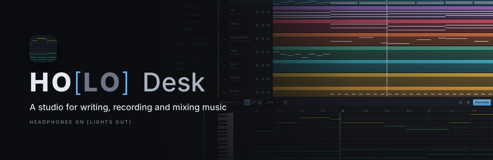
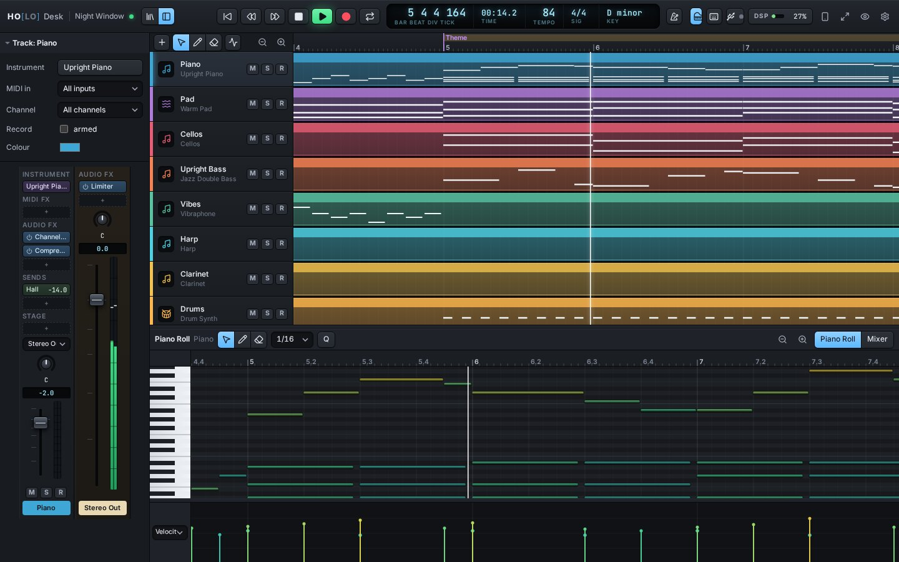
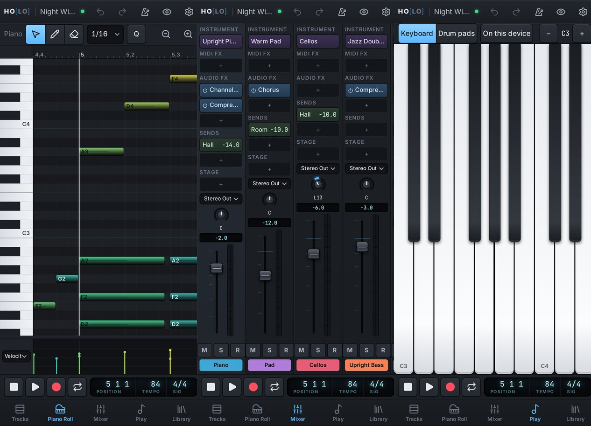

<p align="center"></p>

<p align="center">A studio in your browser for writing, playing and mixing music: tracks, a Piano Roll and a mixer laid out the way Logic users expect, live MIDI from your keyboard and drum pads, orchestral sample packs, and an AI collaborator that works in the open session with you.</p>



## What it does

- **Write and edit.** Tracks and regions on a timeline. A Piano Roll with the keyboard down the left: drag notes to new pitches and times, stretch them, set velocities, and draw any controller (mod wheel, expression, sustain, pitch bend, aftertouch, any CC). Quantize, transpose, split, repeat, undo everything.
- **Play it live.** USB MIDI keyboards and drum pads through Web MIDI, delivered to the audio engine through shared memory: a key you press sounds in the next 128-frame block. You can also play the computer keyboard (Musical Typing) or the touch keyboard and drum pads on a phone. Record with count-in, cycle and metronome. For the shortest time from key to ear, run [HO[LO] Engine](#play-it-in-a-few-milliseconds-holo-engine) on the computer you play on.
- **Record and edit audio.** Audio tracks record a microphone or an instrument through an audio interface (lined up with what you heard, using this device's measured round trip), or take WAV, FLAC, MP3, Ogg and AIFF files dropped on the tracks. Trim from either edge, drag fades, set gain, normalize, and time-stretch without changing pitch (Alt-drag a region's end, as in Logic) in the tracks area or the Audio Editor.
- **Mix and automate.** Channel strips with instruments, MIDI effects, audio effects, sends, buses, pan, faders and meters. Put a channel on a **Stage**: a near seat and a far seat, each with its own rooms and depth, and a Distance that moves it between them. Automation lanes (press <kbd>A</kbd>) draw how volume, pan, mute, sends, distance and any plugin parameter move through the song, in straight lines or smooth curves, sample-accurately.
- **Bounce.** <kbd>Ctrl B</kbd> renders the song (or the cycle) to a 24-bit WAV with the same engine, faster than real time, and keeps a copy with the song. The stock plugins are Channel EQ, Parametric EQ (eight free bands), Compressor, Noise Gate, Transient Softener, Limiter, Space Designer (convolution with generated rooms, halls and cathedrals, or any impulse response), Shimmer, Space Reverb, Tape Delay, Chorus, Wow & Flutter, Stereo Width, Tape Warmth, Saturation, Arpeggiator, Harmonizer, Scale Quantizer and Velocity Processor. Plugins that look ahead (the limiter, Shimmer) are delay-compensated: everything else waits for them, so it all arrives together. A song can carry its **finish** (mastering to a loudness under a true-peak ceiling, with glue) and be marked a **loop**, so a game's music renders as it plays forever, its end ringing into its start.
- **Real instruments.** CC0 sample libraries (VSCO 2 Community Edition, the Versilian Community Sample Library, Karoryfer's Meatbass, a FreePats guitar) with every sample measured for its true pitch, level and loop. **Performance** instruments play a whole part as a real player would (dynamic layers, round robins, legato hand-overs, re-bowing, attacks that land on the beat), and **Glass** is a bowed-glass voice. There is also a built-in synth and drum kit, so something always plays. **Import your own packs** as SFZ or folders of WAV files.
- **An AI collaborator.** A [Claude Code](https://claude.com/claude-code) skill that reads the open session and writes into it as undoable steps. It harmonizes, writes counter-melodies and bass lines, sets up a live harmonizer that follows your playing, and listens to what you play and answers it.
- **Round trips with your own projects.** A game or an app whose music is code can send a piece into HO[LO] and get your edits back, and render the song itself so you can compare its own sound with the studio's, edits and all ([how](docs/creations.md)).
- **Music for your next project.** `holo init` gives a new game or app ("an experience") its songs folder and a pinned copy of HO[LO]'s engine, so the project builds its own music, sample for sample as the studio renders it, with or without HO[LO] Desk; `holo update-engine` moves it on when you choose ([how](docs/creations.md#music-for-a-new-project-an-experience)).
- **Everywhere.** Desktop, tablet and phone (portrait and landscape), installable as an app, in Docker, reached by your own devices over HTTPS on your tailnet.

<p align="center"></p>

## Quick start

You need Node.js 24 or newer and pnpm 10 (`corepack enable`), or just Docker.

```bash
git clone https://github.com/shooter-git/holo-desk.git && cd holo-desk
pnpm install
cp .env.example .env
pnpm packs install          # the CC0 sample libraries (a few GB, fetched with git)
pnpm build && pnpm start    # or `pnpm dev` while working on HO[LO] itself
```

Open <http://localhost:47800> and press **Start the studio**.

**In Docker** (the server, the built studio and your data in `./data`):

```bash
cp .env.example .env
pnpm up                     # docker compose … up -d --build
docker compose --project-directory . -f deploy/compose.yml exec holo node apps/server/src/packs-cli.ts install
```

## Your other devices

Browsers only allow MIDI and shared-memory audio on a secure page. HO[LO] listens on this machine only
(`127.0.0.1`), and [Tailscale](https://tailscale.com) gives your own devices a trusted HTTPS address
with nothing to install on them but the Tailscale app:

```bash
pnpm tailnet on             # https://<this machine>.<your tailnet>.ts.net:47801
```

HO[LO] is hosted on one machine and played on others. Plug your keyboard or drum pads into the laptop
(or other computer, or Android phone) you'll play on, open that address in Chrome, Edge or Firefox
there, and wear your headphones on that device. The notes never cross the network: only the song and
the samples come from the host (once; the device keeps the samples). Give each device a name in
**Audio & MIDI** settings so the others and the AI know which is which. If the host goes away, the
studio keeps working and saves your changes when it's back.

### A studio, a screen and a remote

A common setup: HO[LO] hosted on one machine, the studio full screen on another (<kbd>Ctrl Shift F</kbd>,
or the button beside the settings), and your phone by the instruments as **HO[LO] Remote**: press the
phone button in the studio's control bar and scan the code, or open `/remote` on the phone. The remote
shows the studio's position and levels as they change and drives it: play, stop, record, cycle,
metronome and count-in, undo, the tracks (select, mute, solo, arm) and their faders, markers and *go to
bar*, and a keyboard and drum pads that play into the selected (or armed) track. Add it to the Home
Screen to open it like an app; it keeps the screen awake. Press **Start the studio** on the computer
once, and the remote does the rest.

![HO[LO] Remote on a phone: the display, the transport and the tracks](docs/images/remote.jpg)

Devices that aren't on a tailnet can use HTTPS on your local network instead:

```bash
pnpm lan on                 # https://<this machine's address>:47843, with its own certificate authority
```

Install the certificate it hands out (`http://<this machine>:47844/holo-ca.crt`) on each device once.
Anyone on that network can then use HO[LO], so turn it off (`pnpm lan off`) when you don't need it.

**A keyboard plugged into an iPhone or iPad** reaches the studio through Apple's network MIDI:
`pnpm netmidi on`, then connect a network session to the address it prints, from a MIDI app on the phone.
[Latency and devices](docs/latency-and-devices.md) explains this and the other options. To use the `holo` command from a machine other than the host, point it there:
`HOLO_URL=https://<host>.<your tailnet>.ts.net:47801 holo status`.

## Play it in a few milliseconds: HO[LO] Engine

A browser has to play through the operating system's shared mixer: on Windows that's 20 ms at the very
best, and often 40 or more from key to ear. **HO[LO] Engine** is a small app for the computer you play
on. It plays the studio's sound itself, with native audio (WASAPI exclusive mode on Windows, Core Audio
on macOS), and reads every USB MIDI instrument natively: keyboards, drum pads, controllers, an
interface carrying several instruments. The browser stays the screen.

1. Download it for that computer from the [releases](https://github.com/shooter-git/holo-desk/releases/latest):
   `holo-engine-windows-x64.exe`, `holo-engine-macos-arm64.zip` (Apple silicon), `holo-engine-macos-x64.zip`
   or `holo-engine-linux-x64.zip`. It's one file, with nothing to install.
2. Start it. On Windows, the first time, SmartScreen says it doesn't know the app: **More info → Run
   anyway**. On a Mac, unzip it and the first time right-click it and choose **Open**. A small window
   says it's waiting for the studio.
3. Open HO[LO] Desk in the browser on that computer. The studio finds it by itself, plays through it
   and keeps the browser's own audio quiet (it doesn't even need **Start the studio**). **Audio & MIDI**
   settings says so and shows its numbers. Close the window and the browser plays again.

It plays the same engine as the studio (the same code, the same sound) and opens every MIDI device it
finds, as they're plugged in. Notes go where the browser would send them: armed tracks by their input and
channel, else the selected track. What you play comes back to the studio, timed as you heard it, for
recording. On Windows it has the sound device to itself while the studio is open (exclusive mode: other
apps are silent); tick **Share the sound device with other apps** in Audio & MIDI settings to let them
play too, for a few milliseconds more. How deep it buffers is its own business: it keeps a period in hand, deepens when the device runs short or the computer comes close, opens the device at a longer period when that persists, and remembers what each device needed. [Latency and devices](docs/latency-and-devices.md#holo-engine)
has the details.

From the repository: `pnpm engine:build` once (it needs [Zig 0.16](https://ziglang.org/download/), or a
C compiler for this computer), then `pnpm engine`. `pnpm engine:build --release win32-x64 linux-x64` makes
the downloads in `apps/companion/dist` (the macOS ones build on a Mac).

## The AI collaborator

```bash
pnpm skill:install          # the `holo` command, and the Claude Code skill in every project
holo status                 # what's open, the playhead, the selection, your MIDI devices
holo show --track Strings --from 9 --to 17
holo write --track Strings --at 9 "A4:2 C#5:2 E5:4"
holo fx add Keys harmonizer key=9 scale=6 voice1=2 voice2=4
holo listen --seconds 8
```

Then ask Claude things like *"harmonize the melody in bars 9 to 16 with a counter-line on the oboe"*
or *"put a live harmonizer on my keys in A lydian, thirds and fifths"*. Each change appears in the
open studio as one step you can undo. See [skills/holo/SKILL.md](skills/holo/SKILL.md).

## Sample packs

```bash
pnpm packs list
pnpm packs install vsco2 vcsl          # by name, or all
pnpm packs install --from ~/samples    # from files you already have (hard-linked)
pnpm packs import ~/Downloads/MyPiano.zip --name "My Piano"
```

You can also import from the studio: **Library → Import a sample pack (.zip)**. SFZ instruments come
in with their mapping. Folders of samples named by note (C4, F#3, `_v2`, `_rr1`…) become instruments,
and a folder of one-shot hits becomes a drum kit on the General MIDI keys.

## Key commands

They follow Logic's (Ctrl in place of ⌘): Space play/stop, R record, C cycle, K metronome, X mixer,
P Piano Roll, I Inspector, Y Library, Q quantize, Ctrl T split, Ctrl R repeat, Ctrl Z undo, Ctrl K
Musical Typing, A automation, Ctrl B bounce. Press <kbd>?</kbd> in the studio for the whole list.

## Development

```bash
pnpm dev        # the server (:47800) and the studio with hot reload (:47810)
pnpm engine     # HO[LO] Engine from the repository (after `pnpm engine:build`)
pnpm test       # unit tests
pnpm typecheck
pnpm lint       # Biome
```

| Folder | |
|---|---|
| `apps/web` | the studio: React UI, the engine in an AudioWorklet, Web MIDI |
| `apps/server` | the server: projects (SQLite), packs, the live channel, creations |
| `apps/companion` | HO[LO] Engine: the engine on a render thread, the song rendered ahead on worker threads, with native audio and MIDI (one C file over miniaudio and the OS's MIDI) |
| `packages/engine` | the audio engine: instruments, effects, the mix; the same code live, in bounces and headless (`holo render-audio`) |
| `packages/session` | the session format, operations, notation, MIDI files |
| `packages/music` | an experience's build: the pinned renderer a project carries, its sample fetching and checks |
| `packages/cli` | the `holo` command |
| `skills/holo` | the Claude Code skill |
| `local/` | not in the repository (git ignores it): your own tools for your own creations, such as an importer |
| `packs/manifests` | the CC0 packs' sample maps (no audio), their sources pinned |
| `packs/checksums` | every sample's sha256, checked by installs and by every experience's build |
| `deploy` | Docker |
| `docs` | [architecture](docs/architecture.md), [session format](docs/session-format.md), [creations](docs/creations.md), [latency](docs/latency-and-devices.md) |

The pre-commit hook (`git config core.hooksPath .githooks`) stops commits that would publish a
secret, an email address or a home-folder path.

## Privacy and security

HO[LO] has no accounts and sends nothing anywhere. It binds to `127.0.0.1`, and only devices on your own
tailnet can reach it when you turn that on. HO[LO] Engine listens on `127.0.0.1:47830` only, and lets in
a studio served from this computer, the local network or a tailnet (`--origin` names any other). Your songs and packs stay in `./data`. Read
[SECURITY.md](SECURITY.md) before exposing it any other way.

## Licence and credits

HO[LO] Desk is [MIT licensed](LICENSE). The sample libraries are their authors' work, credited in
[CREDITS.md](CREDITS.md). HO[LO] Desk is an independent project, not affiliated with Apple or Avid.
Logic Pro and Pro Tools are trademarks of their owners and are named here only to describe familiar
workflows.
